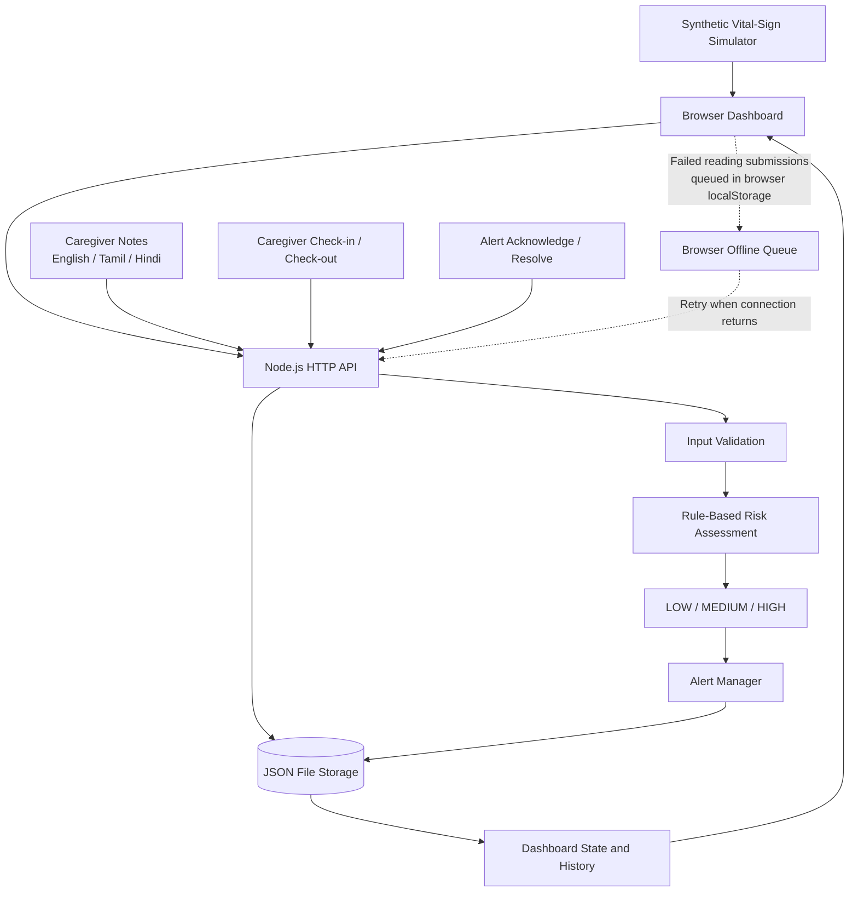

# Operation Ward Zero — System Architecture

## 1. Overview

Operation Ward Zero is a prototype bedroom-scale remote-care monitoring platform. It demonstrates a simulated IoT data flow, transparent rule-based risk scoring, alert handling, and a caregiver dashboard.

**Important:** The prototype uses synthetic vital-sign readings. It is not connected to real medical devices or patients and is not a clinically validated monitoring system.

## 2. Architecture diagram



## 3. Main components

### 3.1 Browser dashboard

The dashboard provides the user interface for:
- Displaying the latest simulated vital-sign readings.
- Selecting Stable, Gradual Deterioration, and Critical scenarios.
- Viewing vital-sign trends and event history.
- Adding caregiver notes and selecting a language label.
- Recording caregiver check-in and check-out.
- Acknowledging and resolving alerts.

The simulator sends readings periodically while a scenario is running.

### 3.2 Node.js HTTP backend

The backend is implemented using Node.js built-in modules. It exposes the following API routes:

| Route | Method | Purpose |
|---|---|---|
| `/api/health` | GET | Backend health check |
| `/api/state` | GET | Retrieve current application state |
| `/api/readings` | POST | Submit a simulated vital-sign reading |
| `/api/notes` | POST | Save a caregiver note |
| `/api/alerts/action` | POST | Acknowledge or resolve an alert |
| `/api/caregiver` | POST | Record caregiver check-in or check-out |
| `/api/reset` | POST | Reset prototype data |

### 3.3 Rule-based risk assessment

Each submitted reading is evaluated using explicit thresholds and a score. The current prototype rules are:

| Vital sign | Condition | Score |
|---|---|---:|
| SpO₂ | Below 90% | +3 |
| SpO₂ | Below 94% (and not below 90%) | +2 |
| Heart rate | At least 125 bpm or below 45 bpm | +3 |
| Heart rate | At least 105 bpm or below 55 bpm (and not in the previous range) | +1 |
| Temperature | At least 39°C | +2 |
| Temperature | At least 38°C (and below 39°C) | +1 |
| Systolic blood pressure | Below 95 mmHg | +2 |
| Systolic blood pressure | Below 100 mmHg (and at least 95 mmHg) | +1 |

The total score maps to a risk level:
- **HIGH:** score of 3 or more.
- **MEDIUM:** score of 1 or 2.
- **LOW:** score of 0.

The dashboard can show the rule-based reasons associated with the assessment. These rules are illustrative prototype logic, not validated clinical thresholds or medical advice.

### 3.4 Alert manager

The alert manager creates and updates alerts based on risk assessments. It supports:
- Open alerts.
- Acknowledging an alert.
- Resolving an alert.
- Escalating an existing active alert when a higher risk level is detected.

The prototype includes a cooldown to reduce repeated alert creation. Alert behavior should be tested during the demo and is not a substitute for a clinical escalation protocol.

### 3.5 JSON persistence

Application state is stored in a local JSON file (`data.json`). The backend retains bounded histories for readings and events. This is suitable for a local demonstration, not a production database or a multi-user deployment.

### 3.6 Caregiver notes and language labels

Caregivers can save notes with a language label (English, Tamil, or Hindi). An optional English summary can be entered manually.

**The notes and manually entered English summaries are stored for display; they are not automatically translated and are not inputs to the current risk-scoring engine.** Do not describe this feature as AI translation or note-based clinical reasoning.

### 3.7 Limited offline retry

The browser stores failed vital-reading submissions in `localStorage` and attempts to retry them when connectivity returns. This is a limited reading-submission retry mechanism.

It does not queue every application action, guarantee delivery, or provide production-grade offline synchronization. The service worker is registered by the frontend; the exact offline behavior should be verified in the target browser before making claims about offline page availability.

## 4. Local setup

Requirements:
- Node.js 20 or later.
- A modern browser.

Run from the project directory:

```bash
npm.cmd start
```

Then open:

```text
http://localhost:3000
```

The project uses Node.js built-in modules and does not require an external package installation for the current prototype.

## 5. Data flow

1. The browser simulator generates synthetic vital-sign values.
2. The dashboard submits each reading to the Node.js API.
3. The backend validates the input and applies the explicit scoring rules.
4. The risk level and explanation are returned as part of the application state.
5. The alert manager creates, updates, or escalates an alert when its conditions are met.
6. Readings, alerts, notes, and caregiver events are persisted in the local JSON file.
7. The dashboard refreshes and displays current readings, trends, alerts, and event history.

## 6. Safety, security, and prototype limitations

- All vital-sign data in the demonstration is synthetic.
- No real patient or medical-device integration is implemented.
- Risk levels are generated by simple, transparent rules; no trained clinical AI model is used.
- The system does not diagnose, recommend treatment, dispatch emergency services, or predict deterioration over a validated 24–48-hour period.
- Caregiver notes do not affect the risk score.
- The current backend uses permissive CORS and has no authentication or authorization. It must not be exposed as a production patient-data service.
- Local JSON storage is not designed for production reliability, concurrent users, or regulated health-data retention.
- The offline queue is limited to failed reading submissions and must not be presented as complete offline functionality.

## 7. Suggested demo sequence

1. Start the application and show the health check/dashboard.
2. Select the Stable scenario and show LOW risk.
3. Select Gradual Deterioration and explain the rule-based score and risk change.
4. Select Critical Readings and show HIGH risk and alert creation/escalation.
5. Demonstrate alert acknowledgment and resolution.
6. Add a caregiver note, emphasizing that it is stored but does not currently change the risk score.
7. Show the architecture and clearly state the synthetic-data and prototype limitations.
